# Benchmarks: Vanillite vs Paper, Vanilla and Pumpkin

<!-- Generated by `cargo xtask bench` from results/latest.json. Do not edit. -->

Measured automatically every night on the newest dev commit with new code (last run 2026-11-27 17:45 UTC, dev `5b96e7b75b36`). Machine-readable: [`results/latest.json`](results/latest.json) (the newest numbers of every scenario), [`results/history.json`](results/history.json) (the compared numbers of every run) and `results/runs/<time>.json` (each run as measured).

**New baseline since 2026-11-27 16:57 UTC:** AMD EPYC-Milan Processor, 6 CPUs and 12 GiB RAM (host: 6 CPUs, 12 GiB). Earlier runs (other hardware, or before the fixed hardware limits) stay in `results/history.json` but are neither compared with these nor drawn on the same line.

## Regressions and improvements

The last run against the run before that measured the same number; listed only beyond the noise (at least 10 % and a small absolute step, more where a number scattered more over the last 10 runs).

**Regressions of Vanillite:** none.

**Improvements of Vanillite:**

- Vanillite, Many players close together: RSS at the last step 292 → 260 MiB (-11 %, noise threshold ±10 %) ⚠ host overloaded during this run

<details><summary>Reference servers beyond the noise threshold (3): their code did not change, so this shows how much the machine itself varied</summary>

- better: Pumpkin, Weak hardware: 1 core, 1 GiB: MSPT max with one moving player 26.03 → 19.61 ms (-25 %, noise threshold ±10 %)
- worse: Paper, Many players close together: most players with MSPT p95 under 50 ms was 100 players, now none (failed)
- better: Paper, Many players close together: RSS at the last step 2688 → 0 MiB (-100 %, noise threshold ±10 %)

</details>

## How to read these numbers

- **Bots are not players.** The load comes from headless bots (`tools/loadbot`): they log in, walk or fly by simple rules, answer keep-alives and count what they receive. They do not render, click, fight or build, and they send fewer packets than real clients. All servers get exactly the same bots.
- **Hardware:** benchmark server: 6 CPUs (0-5) of an AMD EPYC-Milan Processor, 12 GiB RAM, Linux 7.0.0-28-generic (kvm) on a host with 6 CPUs and 12 GiB; nothing else runs on it during runs. Bots: tools/loadbot on the same machine over 127.0.0.1, on 2 CPUs (4,5) the server's profile leaves free (offline mode, no encryption).
- **Same conditions for all:** seed -578941029922802438, normal world, peaceful, view distance 10, simulation distance 10, offline mode, pause-when-empty off, a new world per scenario.
- **Fixed hardware limits:** every server (and the proxy's backend) runs in a cgroup pinned to the first 4 CPUs of the test server with a CPU quota of 400 % and 8 GiB memory, no swap (profile 4c8g; the weak scenario: 1 CPU, 1 GiB), so numbers stay comparable when the test server gets more cores or RAM.
- **Host load:** host load per CPU during each server's run (mean of the 1-minute load averages at its start and end and the 5-minute one at its end); above 1 the run is marked unreliable (⚠) and not used as the base of comparisons.
- **Versions and configuration:**
  - Vanillite: Vanillite dev 26.3, release-fast build, rule profile vanilla (paper profile as extra rows).
  - Paper: Paper 26.3 build 262, default configuration (Paper's own optimisations on), Java 25, -Xms1G -Xmx6G.
  - Vanilla: Mojang's server.jar 26.3, Java 25, -Xms1G -Xmx6G.
  - Pumpkin: Pumpkin 0.2.2+26.3-26.60 release binary (commit eda69440e6369c5f8a05c3f69fc809c40dab93a6), defaults; not like-for-like: its world generation, mob AI and game mechanics are not Vanilla's, and commands it lacks are n/a.
  - vanillite-proxy: vanillite-proxy from the same commit, modern forwarding.
  - Velocity: Velocity 4.3.1 build 45, Java 25, -Xms512M -Xmx2G, modern forwarding.
- **Tick time (MSPT):** Vanillite: every tick (tick log). Paper, Vanilla and Pumpkin: `/tick query` every 5 s (P50/P95/P99/mean of the last 100 ticks), averaged over the window; max is the highest P99 window.
- **One run per night:** expect about ±10 % between runs; look at the history before reading much into one change.
- **What each server can do:** n/a¹ = the server cannot run this scenario (the command or feature is missing; the note says which). error² = the run broke (see the note). failed³ = the server did not reach the load (players dropped, crashed or stopped answering); the ramp stops there. Vanillite is under development: missing commands or features show up here as n/a until they land.

## Summary

One number per scenario and server; the arrow says what is better. In brackets: change against the previous run.

| Scenario | Metric | Vanillite | Vanillite (paper profile) | Paper | Vanilla | Pumpkin | vanillite-proxy | Velocity |
|---|---|---:|---:|---:|---:|---:|---:|---:|
| [Startup time and idle memory](#startup-time-and-idle-memory) | idle RSS (MiB) ↓ | 81.35 (+0 %) | | 1389 (+0 %) | 1017 (+0 %) | 59.7 (+0 %) | | |
| [Redstone: clocks, dust lines and pistons](#redstone-clocks-dust-lines-and-pistons) | mean MSPT (ms) ↓ | 11.54 (+0 %) | | 23.62 (+0 %) | 27.07 (+0 %) | n/a¹ | | |
| [Entity farm: 500 cows in a pen](#entity-farm-500-cows-in-a-pen) | mean MSPT (ms) ↓ | 7.41 (+0 %) | | error² | error² | 1.12 (+0 %) | | |
| [Animal farm: 4 000 animals in a pen](#animal-farm-4-000-animals-in-a-pen) | mean MSPT (ms) ↓ | 37.5 (+0 %) | | error² | error² | 5.67 (+0 %) | | |
| [Monsters: 2 000 hostile mobs hunting villagers](#monsters-2-000-hostile-mobs-hunting-villagers) | mean MSPT (ms) ↓ | 53.39 (+0 %) | | error² | error² | 1.87 (+0 %) | | |
| [Village: 400 villagers with beds and job sites](#village-400-villagers-with-beds-and-job-sites) | mean MSPT (ms) ↓ | 14.53 (+0 %) | | error² | error² | n/a¹ | | |
| [Mobs without players nearby: 4 000 animals in force-loaded chunks](#mobs-without-players-nearby-4-000-animals-in-force-loaded-chunks) | mean MSPT (ms) ↓ | 36.41 (+0 %) | | error² | error² | 4.75 (+0 %) | | |
| [Dropped items: 2 000 item entities](#dropped-items-2-000-item-entities) | mean MSPT (ms) ↓ | 7.17 (+0 %) | | error² | error² | 1.45 (+0 %) | | |
| [Hoppers: 1 024 hoppers moving items in rings](#hoppers-1-024-hoppers-moving-items-in-rings) | mean MSPT (ms) ↓ | 4.23 (+0 %) | | error² | error² | n/a¹ | | |
| [TNT: chain explosions](#tnt-chain-explosions) | mean MSPT (ms) ↓ | 8.26 (+0 %) | | error² | error² ⚠ | 0.55 (+0 %) | | |
| [Flowing water and lava](#flowing-water-and-lava) | mean MSPT (ms) ↓ | 3.91 (+0 %) | | error² | error² | 0.49 (+0 %) | | |
| [Light updates](#light-updates) | mean MSPT (ms) ↓ | 4.28 (+0 %) | | error² | error² | 0.45 (+0 %) | | |
| [World save](#world-save) | save-all flush (s) ↓ | 0.65 (+0 %) | | error² | error² | | | |
| [World pre-generation](#world-pre-generation) | chunks generated per second (chunks/s) ↑ | 416 (+0 %) | | error² | | n/a¹ | | |
| [Weak hardware: 1 core, 1 GiB](#weak-hardware-1-core-1-gib) | MSPT max with one moving player (ms) ↓ | 12.82 (+0 %) | | | | 19.61 (+0 %) | | |
| [Proxy relay](#proxy-relay) | proxy CPU at 500 players (%) ↓ | | | | | | failed³ | 0.51 ⚠ |
| [Flying players: chunk delivery](#flying-players-chunk-delivery) | holes near players at 100 boats (%) ↓ | failed³ ⚠ | | error² | error² | 100 (+0 %) | | |
| [Players spread out](#players-spread-out) | MSPT p95 at 500 players (ms) ↓ | 489 (+0 %) | 501 (+0 %) | error² | error² | 354 ⚠ | | |
| [Join storm](#join-storm) | time until the 1 000 more are in (s) ↓ | failed³ ⚠ | failed³ | failed³ ⚠ | failed³ ⚠ | failed³ ⚠ | | |
| [Many players close together](#many-players-close-together) | most players with MSPT p95 under 50 ms (players) ↑ | 500 (+0 %) ⚠ | 500 (+0 %) | failed³ | failed³ | 100 (+0 %) | | |

## Startup time and idle memory

Start with a new world until the server answers a status ping (cold), restart with that world (warm), then RSS and CPU of the empty, ticking server over 30 s. Run 2026-11-27 17:55 UTC on dev `5b96e7b75b36`.

| Server | Version | Cold start s | Warm start s | Idle RSS MiB | Idle CPU % |
|---|---:|---:|---:|---:|---:|
| Vanillite | 26.3 | 4.99 | 1.16 | 81.35 | 0.53 |
| Paper | Paper 26.3 | 18.25 | 12.83 | 1389 | 4.43 |
| Vanilla | 26.3 | 14.71 | 12.71 | 1017 | 1.27 |
| Pumpkin | 26.3 | 0.33 | 0.33 | 59.7 | 1.43 |

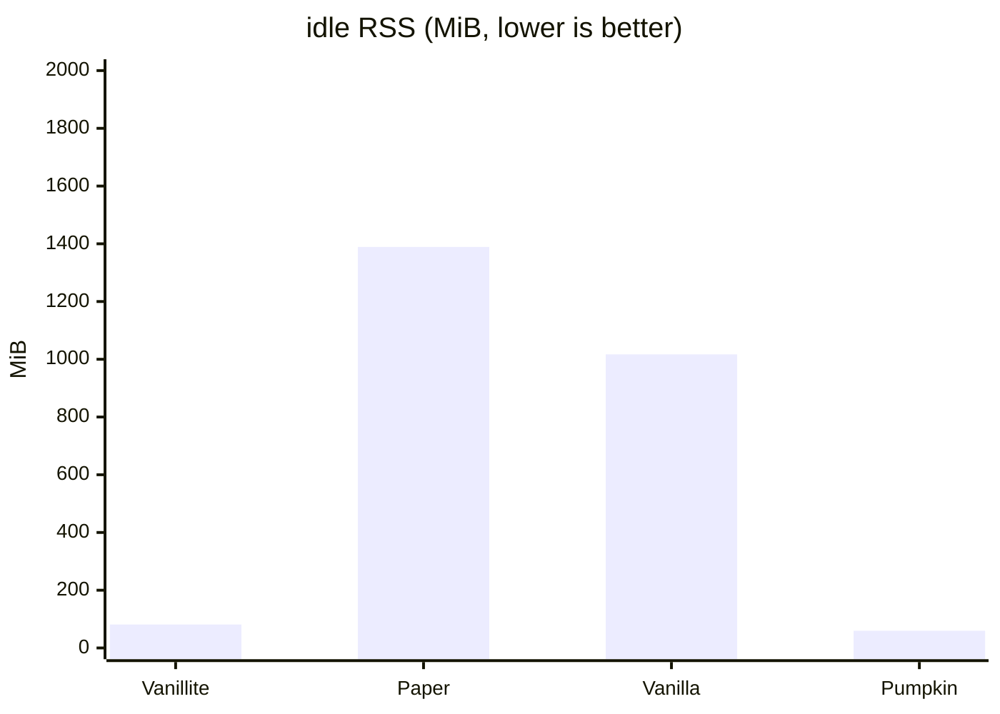

## Redstone: clocks, dust lines and pistons

93 observer clocks, each driving a 15-block redstone dust line into a sticky piston that moves a block (1 395 dust, 93 pistons), on a platform at y 280. Run 2026-11-27 18:02 UTC on dev `5b96e7b75b36`.

| Server | MSPT mean | p50 | p95 | p99 | max | CPU % | RSS MiB |
|---|---:|---:|---:|---:|---:|---:|---:|
| Vanillite | 11.54 | 4.26 | 40.69 | 47.06 | 66.49 | 31.77 | 189 |
| Paper | 23.62 | 24.11 | 36.49 | 49.75 | 73.4 | 71.52 | 1549 |
| Vanilla | 27.07 | 22.64 | 51.38 | 57.77 | 65.1 | 72.96 | 1290 |
| Pumpkin (unsupported) | n/a¹ | – | – | – | – | – | – |

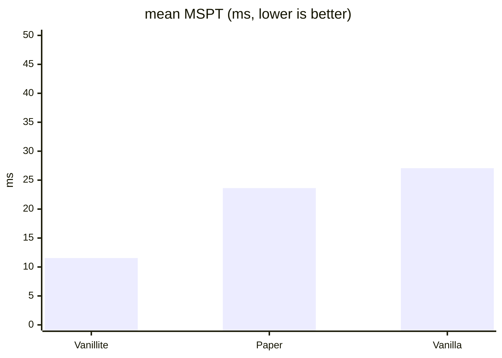

Notes:

- Pumpkin: command not supported: ...cky_piston[facing=up]<--[HERE]

## Entity farm: 500 cows in a pen

500 cows summoned on a grid in a 64 × 64 glass pen (mob AI, pathfinding, collisions, tracking for one player). Run 2026-11-27 18:08 UTC on dev `5b96e7b75b36`.

| Server | MSPT mean | p50 | p95 | p99 | max | CPU % | RSS MiB |
|---|---:|---:|---:|---:|---:|---:|---:|
| Vanillite | 7.41 | 7.23 | 9.24 | 11.32 | 15.7 | 15.73 | 182 |
| Paper (error) | error² | – | – | – | – | – | – |
| Vanilla (error) | error² | – | – | – | – | – | – |
| Pumpkin | 1.12 | 0.98 | 2.04 | 3.41 | 5.63 | 4.78 | 224 |

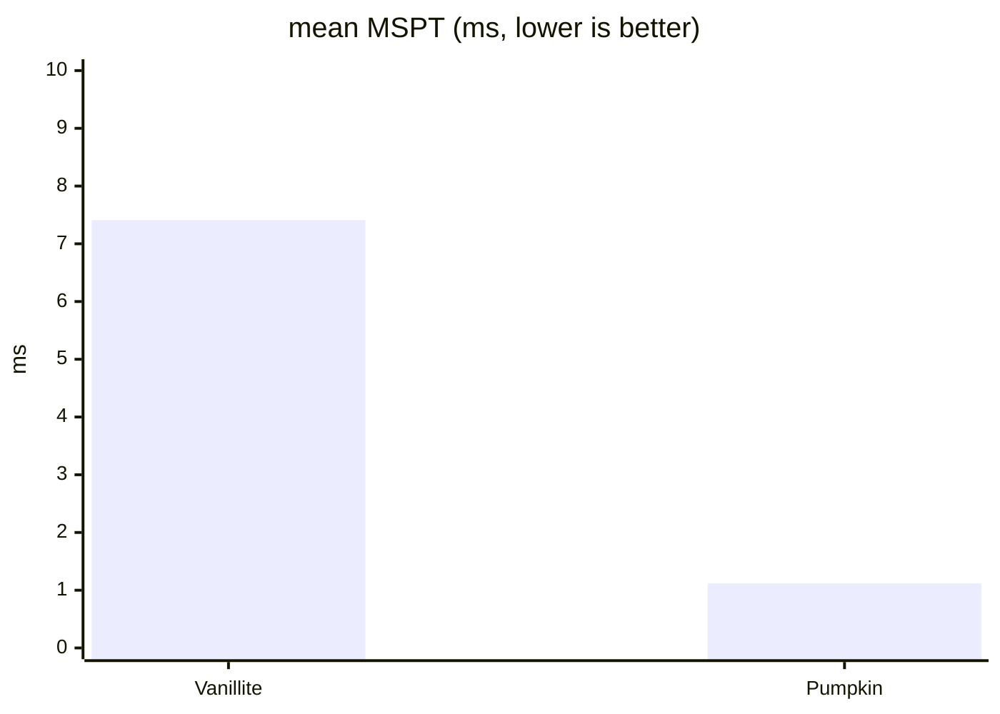

Notes:

- Paper: cmds: EOF while parsing a value at line 1 column 0: 
- Vanilla: cmds: EOF while parsing a value at line 1 column 0: 

## Animal farm: 4 000 animals in a pen

4 000 cows, sheep, pigs and chickens (1 000 each) 1.5 blocks apart in a walled 96 × 96 grass pen under the observer (mob AI, collisions, breeding age, eggs, tracking for one player). Run 2026-11-27 18:12 UTC on dev `5b96e7b75b36`.

| Server | MSPT mean | p50 | p95 | p99 | max | CPU % | RSS MiB |
|---|---:|---:|---:|---:|---:|---:|---:|
| Vanillite | 37.5 | 36.97 | 43.91 | 50.45 | 67.87 | 76.04 | 204 |
| Paper (error) | error² | – | – | – | – | – | – |
| Vanilla (error) | error² | – | – | – | – | – | – |
| Pumpkin | 5.67 | 5.21 | 9.24 | 15.56 | 69.25 | 19.58 | 259 |


Notes:

- Paper: cmds: EOF while parsing a value at line 1 column 0: 
- Vanilla: cmds: EOF while parsing a value at line 1 column 0: 

## Monsters: 2 000 hostile mobs hunting villagers

Difficulty normal: about 2 000 persistent zombies, skeletons, creepers, spiders and slimes in a dark, closed 96 × 96 stone hall with 36 villagers in glass cells the zombies try to reach (targeting, path finding, collisions, despawn checks). Run 2026-11-27 18:15 UTC on dev `5b96e7b75b36`.

| Server | MSPT mean | p50 | p95 | p99 | max | CPU % | RSS MiB |
|---|---:|---:|---:|---:|---:|---:|---:|
| Vanillite | 53.39 | 51.22 | 78.58 | 89.29 | 118 | 101 | 196 |
| Paper (error) | error² | – | – | – | – | – | – |
| Vanilla (error) | error² | – | – | – | – | – | – |
| Pumpkin | 1.87 | 1.68 | 3.14 | 5.05 | 6.6 | 9.06 | 248 |

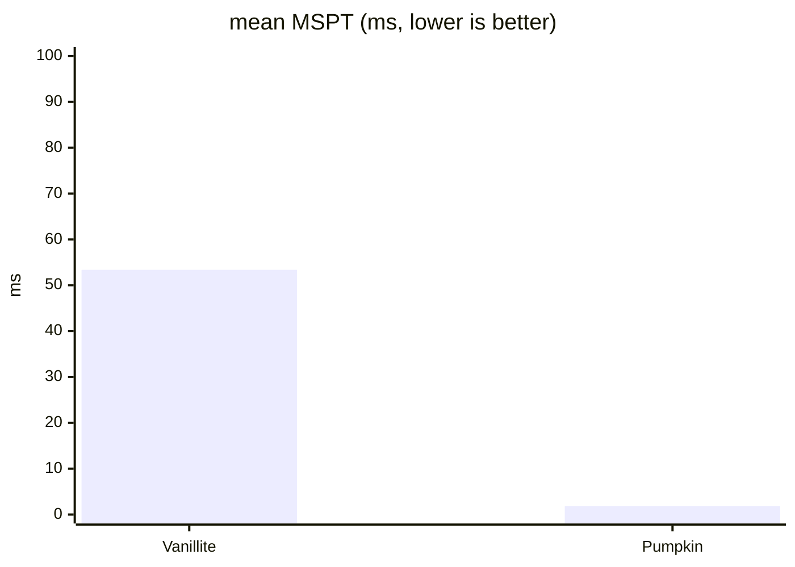

Notes:

- Paper: cmds: EOF while parsing a value at line 1 column 0: 
- Vanilla: cmds: EOF while parsing a value at line 1 column 0: 

## Village: 400 villagers with beds and job sites

400 villagers on a walled 96 × 96 platform, each with a bed and a job site block next to it, and a bell in the middle (brains, sensors, points of interest, gossip, path finding). Run 2026-11-27 18:18 UTC on dev `5b96e7b75b36`.

| Server | MSPT mean | p50 | p95 | p99 | max | CPU % | RSS MiB |
|---|---:|---:|---:|---:|---:|---:|---:|
| Vanillite | 14.53 | 14.15 | 17.58 | 26.26 | 60.41 | 29.97 | 197 |
| Paper (error) | error² | – | – | – | – | – | – |
| Vanilla (error) | error² | – | – | – | – | – | – |
| Pumpkin (unsupported) | n/a¹ | – | – | – | – | – | – |

Notes:

- Paper: cmds: EOF while parsing a value at line 1 column 0: 
- Vanilla: cmds: EOF while parsing a value at line 1 column 0: 
- Pumpkin: command not supported: ...:white_bed[part=foot,facing=north] strict<--[HERE]

## Mobs without players nearby: 4 000 animals in force-loaded chunks

The animal farm in force-loaded chunks, with the only player 2 000 blocks away (mob ticks nobody watches: despawn checks, AI, collisions, no tracking). Run 2026-11-27 18:21 UTC on dev `5b96e7b75b36`.

| Server | MSPT mean | p50 | p95 | p99 | max | CPU % | RSS MiB |
|---|---:|---:|---:|---:|---:|---:|---:|
| Vanillite | 36.41 | 35.83 | 43.06 | 47.53 | 67.87 | 75.11 | 228 |
| Paper (error) | error² | – | – | – | – | – | – |
| Vanilla (error) | error² | – | – | – | – | – | – |
| Pumpkin | 4.75 | 4.47 | 7.28 | 10.17 | 20.01 | 16.64 | 262 |

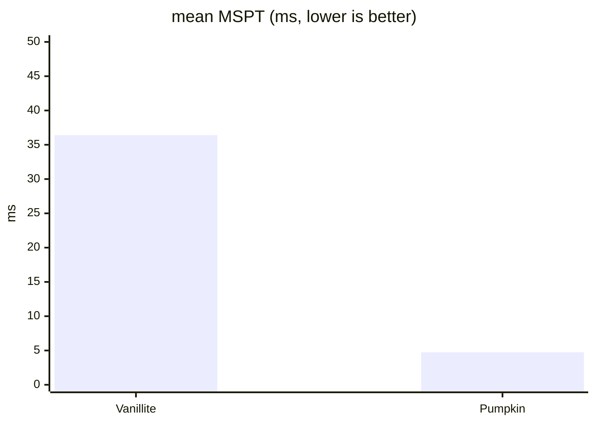

Notes:

- Paper: cmds: EOF while parsing a value at line 1 column 0: 
- Vanilla: cmds: EOF while parsing a value at line 1 column 0: 

## Dropped items: 2 000 item entities

2 000 cobblestone item entities 1.25 blocks apart (no merging, no despawn, no pickup) on a platform. Run 2026-11-27 18:24 UTC on dev `5b96e7b75b36`.

| Server | MSPT mean | p50 | p95 | p99 | max | CPU % | RSS MiB |
|---|---:|---:|---:|---:|---:|---:|---:|
| Vanillite | 7.17 | 7.01 | 8.74 | 10.15 | 17.11 | 15.2 | 179 |
| Paper (error) | error² | – | – | – | – | – | – |
| Vanilla (error) | error² | – | – | – | – | – | – |
| Pumpkin | 1.45 | 1.3 | 2.61 | 4.46 | 5.7 | 7.24 | 227 |

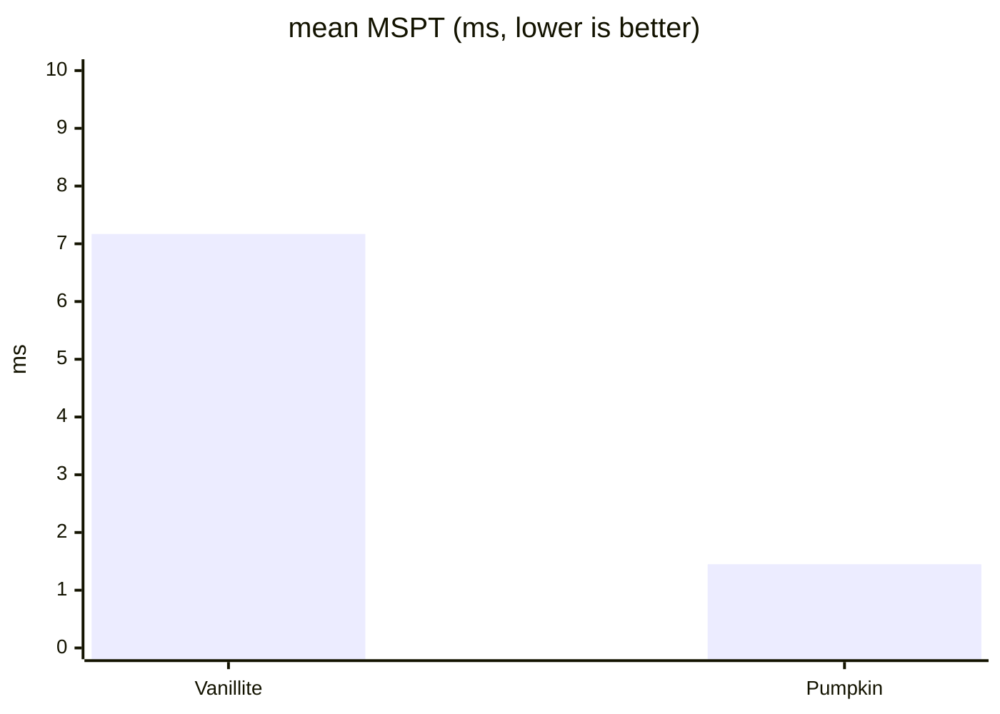

Notes:

- Paper: cmds: EOF while parsing a value at line 1 column 0: 
- Vanilla: cmds: EOF while parsing a value at line 1 column 0: 

## Hoppers: 1 024 hoppers moving items in rings

256 rings of 4 hoppers that pass a stack of 64 items around forever. Run 2026-11-27 18:27 UTC on dev `5b96e7b75b36`.

| Server | MSPT mean | p50 | p95 | p99 | max | CPU % | RSS MiB |
|---|---:|---:|---:|---:|---:|---:|---:|
| Vanillite | 4.23 | 4.15 | 5.33 | 6.07 | 8.02 | 9.29 | 182 |
| Paper (error) | error² | – | – | – | – | – | – |
| Vanilla (error) | error² | – | – | – | – | – | – |
| Pumpkin (unsupported) | n/a¹ | – | – | – | – | – | – |

Notes:

- Paper: cmds: EOF while parsing a value at line 1 column 0: 
- Vanilla: cmds: EOF while parsing a value at line 1 column 0: 
- Pumpkin: command not supported: ...aft:hopper[facing=east]{Items:[{Slot:0b,id:"minecraft:cobblestone",count:64}]}<--[HERE]

## TNT: chain explosions

A 16 × 10 × 16 block of TNT (2 560) ignited in the air every 20 s, three times. Run 2026-11-27 18:30 UTC on dev `5b96e7b75b36`.

| Server | MSPT mean | p50 | p95 | p99 | max | CPU % | RSS MiB |
|---|---:|---:|---:|---:|---:|---:|---:|
| Vanillite | 8.26 | 3.66 | 47.98 | 91.34 | 193 | 17.29 | 194 |
| Paper (error) | error² | – | – | – | – | – | – |
| Vanilla (error) | error² | – | – | – | – | – | – |
| Pumpkin | 0.55 | 0.46 | 1.13 | 2.02 | 3.62 | 3.09 | 222 |

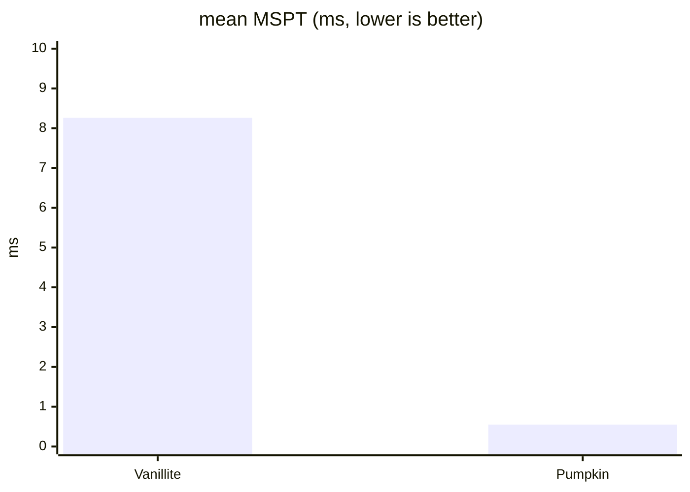

Notes:

- Paper: cmds: EOF while parsing a value at line 1 column 0: 
- Vanilla: cmds: EOF while parsing a value at line 1 column 0: 
- Vanilla: ⚠ unreliable, the host was overloaded during the run (load 0.19 per CPU)

## Flowing water and lava

32 water and 32 lava sources placed on a walled 64 × 64 platform, removed again 10 s later, in turns (spreading and drying up). Run 2026-11-27 18:33 UTC on dev `5b96e7b75b36`.

| Server | MSPT mean | p50 | p95 | p99 | max | CPU % | RSS MiB |
|---|---:|---:|---:|---:|---:|---:|---:|
| Vanillite | 3.91 | 3.57 | 5.06 | 12.85 | 26.78 | 9.17 | 188 |
| Paper (error) | error² | – | – | – | – | – | – |
| Vanilla (error) | error² | – | – | – | – | – | – |
| Pumpkin | 0.49 | 0.42 | 0.96 | 1.71 | 3.19 | 2.78 | 219 |

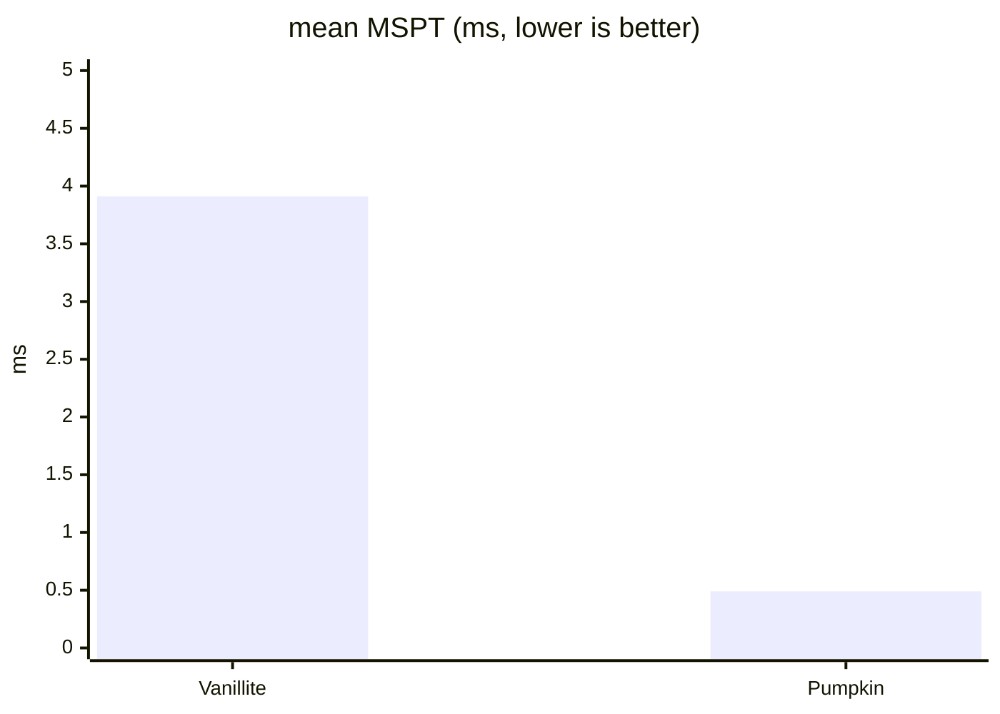

Notes:

- Paper: cmds: EOF while parsing a value at line 1 column 0: 
- Vanilla: cmds: EOF while parsing a value at line 1 column 0: 

## Light updates

A 32 × 32 × 32 cube filled with glowstone and emptied again every 2 s (32 768 light sources appearing and disappearing, with block updates). Run 2026-11-27 19:03 UTC on dev `5b96e7b75b36`.

| Server | MSPT mean | p50 | p95 | p99 | max | CPU % | RSS MiB |
|---|---:|---:|---:|---:|---:|---:|---:|
| Vanillite | 4.28 | 3.4 | 4.82 | 33.94 | 47.23 | 12.09 | 209 |
| Paper (error) | error² | – | – | – | – | – | – |
| Vanilla (error) | error² | – | – | – | – | – | – |
| Pumpkin | 0.45 | 0.38 | 0.85 | 1.95 | 6.66 | 2.58 | 219 |

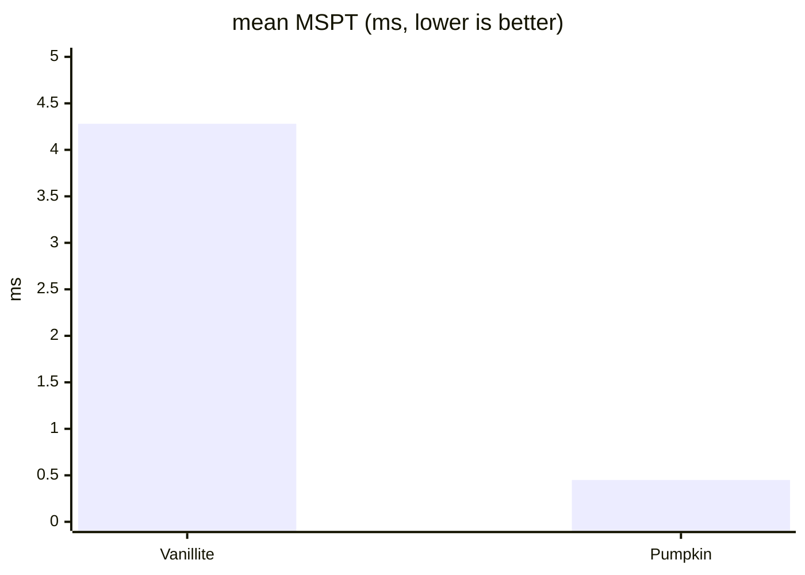

Notes:

- Paper: cmds: EOF while parsing a value at line 1 column 0: 
- Vanilla: cmds: EOF while parsing a value at line 1 column 0: 

## World save

20 bots fly at boat speed (72.7 blocks/s) through new terrain for 60 s, then `save-all flush` until the server reports that everything is on disk. Run 2026-11-27 19:22 UTC on dev `5b96e7b75b36`.

| Server | save-all flush s | Chunks on disk after | Chunks on disk / save s | Chunks/s to the bots while flying | MSPT p95 while flying |
|---|---:|---:|---:|---:|---:|
| Vanillite | 0.65 | 83666 | 127930 | 467 | 38.65 |
| Paper (error) | – | – | – | – | – |
| Vanilla (error) | – | – | – | – | – |

Notes:

- Paper: "ssh" "local" "vanillite-bench 'timed' 'paper' '600' '-' 'save-all' 'flush'" failed: Traceback (most recent call last):
- Vanilla: "ssh" "local" "vanillite-bench 'timed' 'vanilla' '600' '-' 'save-all' 'flush'" failed: Traceback (most recent call last):

## World pre-generation

Generate the 101 × 101 chunks (10 201) around 0, 0 on 4 cores (Vanillite also on 1 and 2 threads), median of 3 runs. Vanillite: the chunk pipeline benchmark (`chunk_bench`: generation, light, storage, then loading the same chunks from disk). Paper: the Chunky plugin (radius 800, square) in the running server. Pumpkin has no pre-generation command (its chunk generation under load: Flying players). Run 2026-11-27 19:26 UTC on dev `5b96e7b75b36`.

| Server | Chunks/s | Chunks/s with 1 / 2 threads | CPU ms per chunk | First chunk ms | Peak RSS MiB | Load from disk chunks/s | Method |
|---|---:|---:|---:|---:|---:|---:|---:|
| Vanillite | 416 | 112 / 232 | 9.42 | 7277 | 630 | 14347 | `chunk_bench --radius 50 --threads 4 --pump --load` |
| Paper (error) | – | – / – | – | – | – | – | – |
| Pumpkin (unsupported) | – | – / – | – | – | – | – | – |

Notes:

- Paper: cmds: EOF while parsing a value at line 1 column 0: 
- Pumpkin: no pre-generation command

## Weak hardware: 1 core, 1 GiB

The server in a cgroup with a CPU quota of one core and a memory limit of 1 GiB, like a small Pterodactyl server: idle RSS, then one player walks (sprint speed) and flies (10 blocks/s) straight through new terrain with the movement checks on. Rubber-banding: server teleports of the bot. Run 2026-11-27 20:21 UTC on dev `5b96e7b75b36`.

| Server | Limits | Start s | Idle RSS MiB | Movement | MSPT p50 | MSPT p99 | MSPT max | RSS MiB | Teleports |
|---|---:|---:|---:|---:|---:|---:|---:|---:|---:|
| Vanillite | 100 % CPU, 1024 MiB | 5.68 | 89.47 | straight:sprint | 3.92 | 8.15 | 12.82 | 160 | 0 |
| Vanillite | 100 % CPU, 1024 MiB | 5.68 | 89.47 | straight:10 | 3.67 | 7.8 | 10.26 | 174 | 0 |
| Pumpkin | 100 % CPU, 1024 MiB | 0.32 | 58.66 | straight:sprint | 3.98 | 15.74 | 19.56 | 265 | 0 |
| Pumpkin | 100 % CPU, 1024 MiB | 0.32 | 58.66 | straight:10 | 3.5 | 14.44 | 19.61 | 304 | 0 |

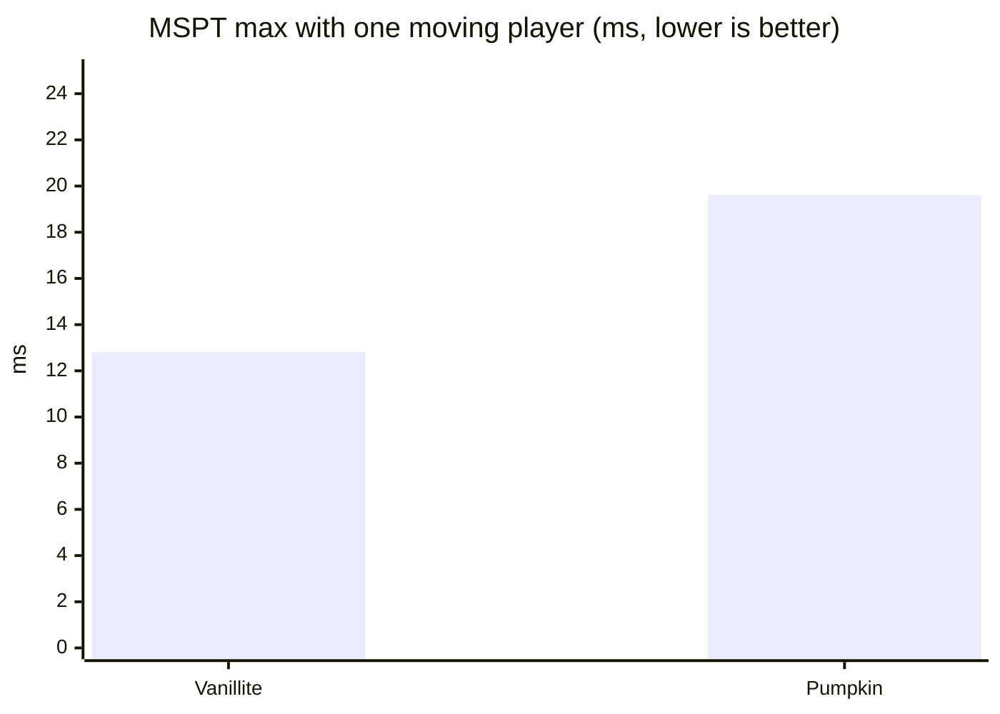

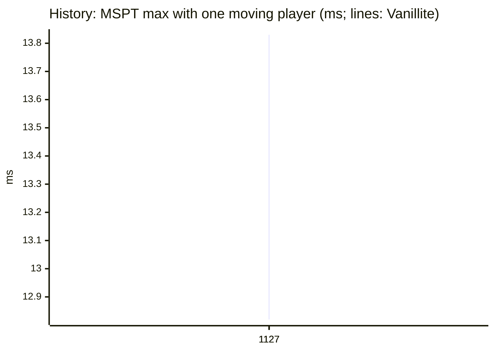

## Proxy relay

Players join through a proxy on 30900 into Vanillite on 30901 (modern forwarding) and walk randomly: cost of the proxy process. Run 2026-11-27 20:29 UTC on dev `5b96e7b75b36`.

| Server | Players | MSPT p50 | p95 | p99 | max | RSS MiB | RSS per player KiB | CPU % | Out KB/s per player | Join: ramp s / p95 ms | RTT p95 ms | Chunks/s per bot | Server CPU ms per chunk | Full view p95 ms | Holes near players % | Teleports |
|---|---:|---:|---:|---:|---:|---:|---:|---:|---:|---:|---:|---:|---:|---:|---:|---:|
| vanillite-proxy (failed) | 100 / 100 | – | – | – | – | 0 | – | – | – | 12 / 969 | 48.35 | 7.67 | – | 9960 | 0 | 0 |
| Velocity | 100 / 100 | – | – | – | – | 169 | 0.12 | 0.7 | 0 | 9 / 521 | 48.73 | 7.71 | 0.01 | 1514 | 0 | 0 |
| Velocity | 500 / 500 | – | – | – | – | 169 | 0.04 | 0.51 | 0 | 33.01 / 923 | 37096 | 7.25 | 0 | 67770 | 8.31 | 0 |

Notes:

- vanillite-proxy: failed at 100 players (100 online)
- Velocity: ⚠ unreliable, the host was overloaded during the run (load 1.25 per CPU)

## Flying players: chunk delivery

Bots fly straight at y 300 in random directions, first 50 with elytra speed (33.5 blocks/s), then 100 at boat speed (72.7 blocks/s): new terrain is generated and sent all the time; the movement check game rule is off on every server. Holes: chunks within 2 chunks of a bot that it does not have, sampled every 5 s. Full view: from connecting until every chunk within the view distance (circle) is there. Server CPU per chunk: CPU time of the server process divided by the chunks the bots received. Run 2026-11-27 20:32 UTC on dev `5b96e7b75b36`.

| Server | Players | MSPT p50 | p95 | p99 | max | RSS MiB | RSS per player KiB | CPU % | Out KB/s per player | Join: ramp s / p95 ms | RTT p95 ms | Chunks/s per bot | Server CPU ms per chunk | Full view p95 ms | Holes near players % | Teleports |
|---|---:|---:|---:|---:|---:|---:|---:|---:|---:|---:|---:|---:|---:|---:|---:|---:|
| Vanillite (failed) | 50 / 50 | 28.33 | 45.07 | 53.39 | 75.33 | 757 | 13527 | 353 | 0 | 4 / 335 | 1.49 | 16.36 | 4.31 | 2039 | 79.81 | 0 |
| Vanillite (failed) | 50 / 100 | 42.63 | 69.24 | 86.07 | 108 | 1282 | 24274 | 276 | 0 | 31.02 / – | 1.55 | 2.34 | 23.61 | – | 98.66 | 0 |
| Paper (error) | – | – | – | – | – | – | – | – | – | – | – | – | – | – | – | – |
| Vanilla (error) | – | – | – | – | – | – | – | – | – | – | – | – | – | – | – | – |
| Pumpkin | 50 / 50 | 7.6 | 12.95 | 21.43 | 31.2 | 720 | 13315 | 221 | 0 | 4 / 484 | 42.3 | 0 | – | – | 100 | 0 |
| Pumpkin | 100 / 100 | 21.7 | 30.09 | 33.8 | 39.69 | 1224 | 11812 | 228 | 0 | 4 / 24.45 | 45.24 | 0 | 7859 | – | 100 | 0 |

Notes:

- Vanillite: failed at 100 players (50 online)
- Vanillite: ⚠ unreliable, the host was overloaded during the run (load 1.25 per CPU)
- Paper: cmds: EOF while parsing a value at line 1 column 0: 
- Vanilla: cmds: EOF while parsing a value at line 1 column 0: 

## Players spread out

Bots fly to random points within 1 500 blocks of the spawn and stay there: every player has its own chunks. Run 2026-11-27 20:37 UTC on dev `5b96e7b75b36`.

| Server | Players | MSPT p50 | p95 | p99 | max | RSS MiB | RSS per player KiB | CPU % | Out KB/s per player | Join: ramp s / p95 ms | RTT p95 ms | Chunks/s per bot | Server CPU ms per chunk | Full view p95 ms | Holes near players % | Teleports |
|---|---:|---:|---:|---:|---:|---:|---:|---:|---:|---:|---:|---:|---:|---:|---:|---:|
| Vanillite | 100 / 100 | 102 | 153 | 183 | 228 | 1033 | 9597 | 249 | 0 | 7 / 161 | 1.38 | 2.66 | 9.36 | 1665 | 51.57 | 0 |
| Vanillite | 250 / 250 | 251 | 305 | 349 | 360 | 1641 | 6330 | 191 | 0 | 25.01 / 788 | 1.42 | 1.18 | 6.47 | 2300 | 25.4 | 0 |
| Vanillite | 500 / 500 | 444 | 489 | 513 | 588 | 2294 | 4502 | 177 | 0 | 75.03 / 1388 | 1.31 | 0.43 | 8.24 | 9716 | 9.14 | 0 |
| Vanillite (paper profile) | 100 / 100 | 110 | 160 | 192 | 225 | 1056 | 9827 | 250 | 0 | 7 / 164 | 1.21 | 2.82 | 8.87 | 2047 | 49.38 | 0 |
| Vanillite (paper profile) | 250 / 250 | 268 | 310 | 352 | 353 | 1685 | 6507 | 190 | 0 | 27.01 / 874 | 1.2 | 1.12 | 6.75 | 2499 | 23.76 | 0 |
| Vanillite (paper profile) | 500 / 500 | 451 | 501 | 557 | 575 | 2340 | 4595 | 176 | 0 | 80.02 / 1558 | 1.1 | 0.44 | 8.06 | 11926 | 5.81 | 0 |
| Paper (error) | – | – | – | – | – | – | – | – | – | – | – | – | – | – | – | – |
| Vanilla (error) | – | – | – | – | – | – | – | – | – | – | – | – | – | – | – | – |
| Pumpkin | 100 / 100 | 9.32 | 13.87 | 19.54 | 27.7 | 1611 | 15796 | 243 | 0 | 7 / 349 | 50.43 | 0.16 | 154 | – | 96.65 | 0 |
| Pumpkin | 250 / 250 | 31.67 | 43.99 | 60.66 | 146 | 2813 | 11240 | 322 | 0 | 13 / 533 | 51.64 | 1.11 | 11.57 | – | 77.37 | 0 |
| Pumpkin | 500 / 500 | 127 | 354 | 632 | 1176 | 5266 | 10643 | 382 | 0 | 55.01 / 1906 | 3249 | 3.93 | 1.95 | – | 22.31 | 0 |

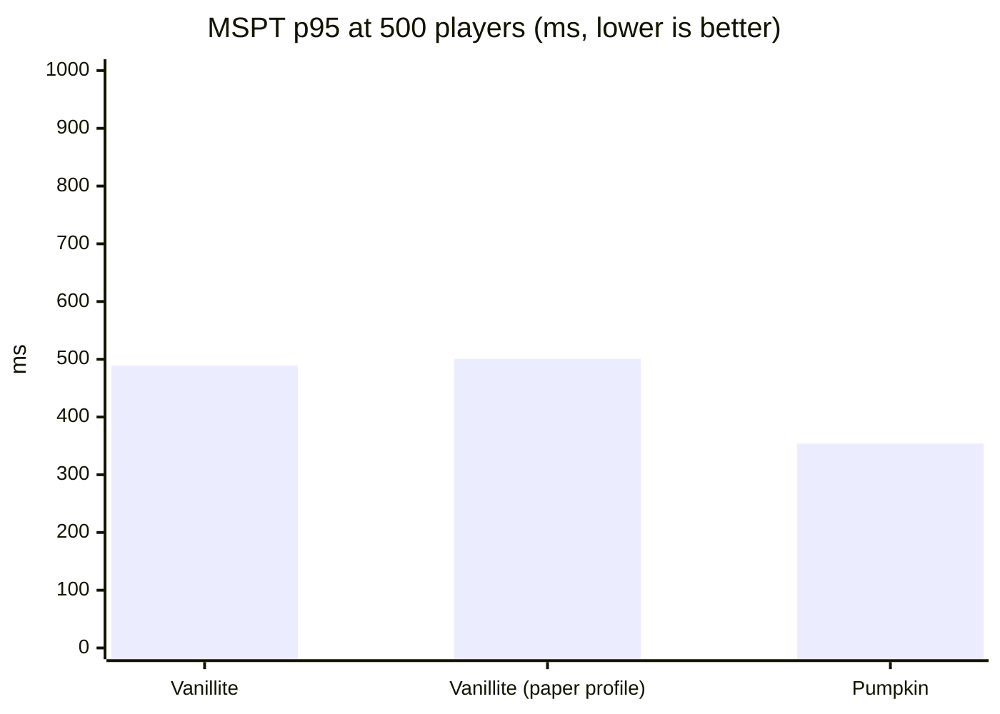

Notes:

- Paper: cmds: EOF while parsing a value at line 1 column 0: 
- Vanilla: cmds: EOF while parsing a value at line 1 column 0: 
- Pumpkin: ⚠ unreliable, the host was overloaded during the run (load 1.32 per CPU)

## Join storm

1 000 bots join at 20 per second; then 1 000 more connect at once (up to 256 logins at the same time). Run 2026-11-27 20:55 UTC on dev `5b96e7b75b36`.

| Server | Players | MSPT p50 | p95 | p99 | max | RSS MiB | RSS per player KiB | CPU % | Out KB/s per player | Join: ramp s / p95 ms | RTT p95 ms | Chunks/s per bot | Server CPU ms per chunk | Full view p95 ms | Holes near players % | Teleports |
|---|---:|---:|---:|---:|---:|---:|---:|---:|---:|---:|---:|---:|---:|---:|---:|---:|
| Vanillite (failed) | 1000 / 1000 | 50 | 61.18 | 68.59 | 73.12 | 473 | 385 | 259 | 0 | 61.03 / 336 | 73.9 | 7.01 | 0.37 | 713 | 0 | 942 |
| Vanillite (failed) | 1730 / 2000 | 78.63 | 102 | 114 | 114 | 674 | 341 | 265 | 0 | 104 / 1453 | 353 | 1.97 | 0.78 | 2061 | 0 | 499 |
| Vanillite (paper profile) (failed) | 1000 / 1000 | 51.49 | 79.46 | 124 | 126 | 457 | 370 | 259 | 0 | 60.02 / 353 | 92.2 | 6.37 | 0.41 | 706 | 0 | 167 |
| Vanillite (paper profile) (failed) | 1804 / 2000 | 88.95 | 110 | 155 | 186 | 686 | 335 | 269 | 0 | 114 / 1509 | 512 | 2.06 | 0.72 | 2122 | 0 | 98 |
| Paper (failed) | 187 / 1000 | – | – | – | – | 0 | 0 | – | – | 419 / 4782 | 33226 | 17.91 | – | 75487 | 0 | 0 |
| Vanilla (failed) | 349 / 1000 | – | – | – | – | 0 | 0 | – | – | 614 / 14552 | 25491 | 5.22 | – | 43635 | 0 | 0 |
| Pumpkin (failed) | 332 / 1000 | 203 | 8045 | 10779 | 10779 | 2890 | 8700 | 398 | 0 | 124 / 1331 | 48078 | 13.09 | 1.12 | 40550 | 39 | 0 |

Notes:

- Vanillite: failed at 2000 players (1730 online)
- Vanillite: ⚠ unreliable, the host was overloaded during the run (load 1.27 per CPU)
- Vanillite (paper profile): failed at 2000 players (1804 online)
- Paper: failed at 1000 players (187 online)
- Paper: ⚠ unreliable, the host was overloaded during the run (load 1.58 per CPU)
- Vanilla: failed at 1000 players (349 online)
- Vanilla: ⚠ unreliable, the host was overloaded during the run (load 2.04 per CPU)
- Pumpkin: failed at 1000 players (332 online)
- Pumpkin: ⚠ unreliable, the host was overloaded during the run (load 2.18 per CPU)

## Many players close together

Bots walk randomly within 48 blocks of the spawn, 60 s per step (measured over the last 50 s), up to 5 000. A server that stops answering or drops the bots ends its ramp there. Run 2026-11-27 21:22 UTC on dev `5b96e7b75b36`.

| Server | Players | MSPT p50 | p95 | p99 | max | RSS MiB | RSS per player KiB | CPU % | Out KB/s per player | Join: ramp s / p95 ms | RTT p95 ms | Chunks/s per bot | Server CPU ms per chunk | Full view p95 ms | Holes near players % | Teleports |
|---|---:|---:|---:|---:|---:|---:|---:|---:|---:|---:|---:|---:|---:|---:|---:|---:|
| Vanillite (failed) | 100 / 100 | 9.59 | 12.26 | 14.18 | 20.79 | 241 | 1487 | 38.98 | 0 | 7 / 129 | 1.29 | 8.07 | 0.48 | 1548 | 0 | 113 |
| Vanillite (failed) | 500 / 500 | 25.59 | 31.88 | 40.66 | 81.34 | 310 | 439 | 129 | 0 | 22 / 140 | 1.96 | 7.7 | 0.34 | 398 | 0 | 550 |
| Vanillite (failed) | 1000 / 1000 | 52.74 | 64.56 | 72.5 | 107 | 476 | 389 | 258 | 0 | 35.01 / 410 | 69.16 | 7.07 | 0.36 | 734 | 0 | 946 |
| Vanillite (failed) | 2000 / 2000 | 90.34 | 119 | 135 | 177 | 832 | 377 | 266 | 0 | 217 / 1667 | 578 | 1.61 | 0.83 | 2427 | 0 | 407 |
| Vanillite (failed) | 0 / 5000 | 0.18 | 0.25 | 0.46 | 73.47 | 260 | – | 0.62 | – | 461 / 4941 | – | – | – | 6091 | – | 0 |
| Vanillite (paper profile) (failed) | 100 / 100 | 8.69 | 11.69 | 15.35 | 21.29 | 242 | 1490 | 37.89 | 0 | 7 / 135 | 1.25 | 7.9 | 0.48 | 1805 | 0 | 110 |
| Vanillite (paper profile) (failed) | 500 / 500 | 24.54 | 30.14 | 34.16 | 45.96 | 308 | 433 | 125 | 0 | 22 / 136 | 1.74 | 7.81 | 0.32 | 435 | 0 | 494 |
| Vanillite (paper profile) (failed) | 1000 / 1000 | 47.11 | 58.26 | 68.99 | 85.35 | 457 | 369 | 246 | 0 | 33.01 / 346 | 67.3 | 7.27 | 0.34 | 655 | 0 | 1149 |
| Vanillite (paper profile) (failed) | 2000 / 2000 | 86.64 | 102 | 120 | 188 | 808 | 364 | 268 | 0 | 220 / 1796 | 662 | 1.53 | 0.88 | 2489 | 0 | 483 |
| Vanillite (paper profile) (failed) | 0 / 5000 | 0.22 | 0.51 | 1.27 | 93.03 | 270 | – | 1.27 | – | 496 / 5482 | – | – | – | 6807 | – | 0 |
| Paper (failed) | 100 / 100 | – | – | – | – | 0 | 0 | – | – | 17 / 1203 | 49.65 | 7.69 | – | 3126 | 0 | 0 |
| Vanilla (failed) | 100 / 100 | – | – | – | – | 0 | 0 | – | – | 17.01 / 1084 | 48.18 | 7.83 | – | 3615 | 0 | 0 |
| Pumpkin (failed) | 100 / 100 | 21.17 | 34.05 | 42.84 | 57.55 | 645 | 5902 | 153 | 0 | 12 / 1124 | 45.98 | 7.67 | 2 | 15346 | 0 | 0 |
| Pumpkin (failed) | 500 / 500 | 130 | 4444 | 6227 | 7343 | 2006 | 3967 | 373 | 0 | 36.01 / 981 | 39124 | 7.62 | 1.55 | 59944 | 12.25 | 0 |
| Pumpkin (failed) | 187 / 1000 | 52.6 | 1239 | 2163 | 10656 | 2649 | 14127 | 170 | 0 | 75.02 / 1059 | 46283 | 16.87 | 1.34 | 59932 | 2.51 | 0 |

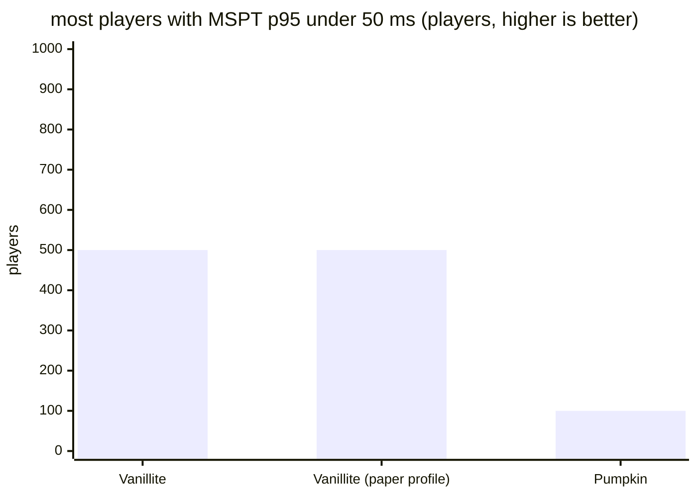

```mermaid
xychart-beta
    title "History: most players with MSPT p95 under 50 ms (players; lines: Vanillite)"
    x-axis ["1127", "1127"]
    y-axis "players"
    line [500, 500]
```

Notes:

- Vanillite: failed at 5000 players (0 online)
- Vanillite: ⚠ unreliable, the host was overloaded during the run (load 1.12 per CPU)
- Vanillite (paper profile): failed at 5000 players (0 online)
- Paper: failed at 100 players (100 online)
- Vanilla: failed at 100 players (100 online)
- Pumpkin: failed at 1000 players (187 online)

